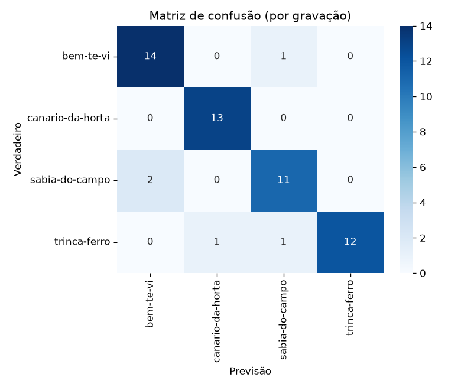

# Classificação de pássaros pelo canto com CNN

Rede neural convolucional que identifica qual de quatro espécies brasileiras está cantando
numa gravação, a partir do espectrograma do áudio.

Feito com Python 3.12, TensorFlow 2.19 (Keras 3), librosa e scikit-learn.

| Espécie | Nome científico | No código |
|---|---|---|
| Bem-te-vi | *Pitangus sulphuratus* | `bem-te-vi` |
| Canário-da-terra | *Sicalis flaveola* | `canario-da-horta` |
| Sabiá-do-campo | *Mimus saturninus* | `sabia-do-campo` |
| Trinca-ferro | *Saltator similis* | `trinca-ferro` |

Projeto feito como trabalho final da disciplina de Inteligência Artificial do curso de
Sistemas de Informação da Unimontes (2025). Ele foi revisado depois para corrigir um vazamento
de dados na avaliação (veja [abaixo](#o-vazamento-de-dados-que-inflava-a-acurácia)).

## Resultados

Teste feito só com gravações que o modelo nunca ouviu. Média de 3 treinos com sementes
diferentes:

| Métrica | Por trecho de 5 s | Por gravação inteira |
|---|---|---|
| Acurácia | **81,5%** ± 2,3 | **92,1%** ± 1,7 |
| F1 macro | 81,4% ± 2,6 | 92,0% ± 1,7 |

Com quatro classes, um chute acerta 25%. Para avaliar por gravação, o modelo soma as
probabilidades de todos os trechos de 5 s da gravação e dá uma resposta só. É assim que ele
seria usado na prática. Cada teste tem cerca de 55 gravações (300 trechos), por isso o desvio
entre os treinos.

<p align="center">
  
</p>

A confusão mais comum é entre o bem-te-vi e o sabiá-do-campo. As curvas de treino e os
relatórios por espécie de cada execução estão em [`resultados/`](resultados/).

## O vazamento de dados que inflava a acurácia

Na versão original do trabalho, cada gravação era cortada em trechos de 5 s e **cada trecho
era sorteado sozinho** para treino, validação ou teste. Só que os trechos de uma mesma
gravação são quase iguais: o mesmo pássaro, o mesmo microfone, o mesmo ruído de fundo. Com
isso, o teste tinha "irmãos" de trechos que o modelo já tinha visto no treino, e ele podia
acertar reconhecendo **a gravação**, não **a espécie**.

Na divisão original, 189 das 199 gravações do teste também tinham trechos no treino.

A correção foi dividir **por gravação**: todos os trechos de uma gravação ficam no mesmo
conjunto. Para medir o efeito, o mesmo modelo foi treinado com os mesmos dados e as mesmas
sementes, mudando só a divisão:

| Divisão | Gravações do teste que também estão no treino | Acurácia por trecho |
|---|---|---|
| Por trecho (original, com vazamento) | 192 de 207 | 92,3% ± 0,3 |
| Por gravação (corrigida) | 0 de 55 | **81,5%** ± 2,3 |

Os cerca de 11 pontos de diferença eram o modelo "decorando" gravações. O número de 81,5%
é menor, mas é o que vale para uma gravação nova.

## Como funciona

```
xeno-canto (API REST)  →  MP3  →  trechos de 5 s  →  espectrograma mel  →  CNN  →  espécie
   baixar_audios.py          gerar_espectrogramas.py         dividir_dataset.py + treinar.py
```

1. **Coleta** (`src/baixar_audios.py`): busca na API v3 do [xeno-canto](https://xeno-canto.org)
   gravações de canto (`type:song`) feitas no Brasil, com qualidade A ou B e pelo menos 5 s,
   até 100 por espécie. Também grava o autor e a licença de cada gravação.
2. **Espectrogramas** (`src/gerar_espectrogramas.py`): converte para mono a 22.050 Hz, corta
   em trechos de 5 s, descarta os silenciosos (abaixo de −40 dBFS) e salva o espectrograma
   mel (128 bandas, em dB) de cada trecho como imagem.
3. **Divisão** (`src/dividir_dataset.py`): 70% / 15% / 15% das gravações de cada espécie para
   treino, validação e teste.
4. **Treino** (`src/treinar.py`): CNN com 3 blocos de convolução e max pooling, uma camada
   densa de 128 neurônios com dropout de 50% e saída softmax. Tem parada antecipada pela perda
   na validação e pesos por classe para compensar o desequilíbrio entre as espécies.
5. **Previsão** (`src/prever.py`): recebe um MP3 ou WAV e diz a espécie.

Dados usados: 365 gravações e 2.454 espectrogramas (bem-te-vi 100 e 538; canário-da-terra 85
e 528; sabiá-do-campo 83 e 617; trinca-ferro 97 e 771).

### O que mudou em relação à versão original

O código original, exportado do Google Colab, está em
[`notebooks_originais/`](notebooks_originais/) para comparação. As mudanças:

- **Divisão por gravação**, no lugar de trecho a trecho (a seção acima).
- **Aumento de dados adequado a áudio.** A versão original girava e espelhava as imagens,
  o que num espectrograma inverte o tempo ou mistura frequências e não corresponde a nenhum
  canto real. Agora só há deslocamento no eixo do tempo.
- **Parada antecipada e pesos por classe**, no lugar de 20 épocas fixas.
- **Avaliação por gravação**, além de por trecho, e média de 3 sementes.
- **O último trecho de cada gravação é completado com silêncio** até 5 s, para todas as
  imagens terem a mesma escala de tempo.
- **A chave da API sai do código** e passa a ser lida da variável de ambiente `XENO_CANTO_API_KEY`.
- **O download confere se a resposta é mesmo áudio.** Três "MP3" da coleta original eram
  páginas de erro em HTML.
- O pipeline virou scripts com caminhos relativos, que rodam fora do Colab e para todas as
  espécies de uma vez.

A arquitetura da rede é a mesma da versão original, de propósito: assim a comparação mede só
o efeito da divisão dos dados.

## Como rodar

Requer Python 3.10 a 3.12.

```bash
python -m venv .venv
.venv\Scripts\activate          # Windows  (Linux/macOS: source .venv/bin/activate)
pip install -r requirements.txt
```

As gravações não fazem parte do repositório (veja [Créditos](#créditos-e-licença)). Para
baixá-las, crie uma chave em xeno-canto.org e rode:

```bash
set XENO_CANTO_API_KEY=sua_chave      # Windows  (Linux/macOS: export XENO_CANTO_API_KEY=...)
cd src
python baixar_audios.py --limite 100
python gerar_espectrogramas.py
python treinar.py --modo gravacao --sementes 3
python prever.py ../dados/audios/sabia-do-campo/102991_Mimus_saturninus.mp3
```

Para reproduzir a comparação com a divisão antiga: `python treinar.py --modo trecho --sementes 3`.
O treino roda em CPU. Num notebook com 12 núcleos, cada execução levou cerca de 5 minutos.

Exemplo de saída do `prever.py` com uma gravação do conjunto de teste:

```
5 trechos analisados
  sabia-do-campo      76.6%
  trinca-ferro        12.0%
  bem-te-vi           10.9%
  canario-da-horta     0.5%

Espécie prevista: sabia-do-campo
```

## Estrutura

```
src/
  config.py                 caminhos, espécies e parâmetros
  baixar_audios.py          coleta no xeno-canto
  gerar_espectrogramas.py   trechos de 5 s → espectrogramas mel
  dividir_dataset.py        treino/validação/teste por gravação (ou por trecho, para comparar)
  treinar.py                treino, avaliação, gráficos e métricas
  prever.py                 espécie de uma gravação nova
resultados/                 métricas, relatórios, matrizes de confusão e curvas de cada execução
notebooks_originais/        código original do trabalho (Colab), sem a chave da API
```

## Limitações e próximos passos

- **Poucos dados.** São cerca de 90 gravações por espécie, e o teste tem só 55. Cada erro
  pesa quase 2 pontos percentuais.
- **Uma espécie por gravação.** As gravações do xeno-canto muitas vezes têm outras aves ao
  fundo, e o modelo não separa as vozes.
- **Classes fechadas.** O modelo sempre responde uma das quatro espécies, mesmo que a
  gravação seja de outra ave.
- **Próximos passos:** *transfer learning* com uma rede pré-treinada em áudio (por exemplo,
  embeddings do BirdNET ou de uma CNN treinada no AudioSet), validação cruzada por grupos
  (`StratifiedGroupKFold`) e aumento de dados próprio para áudio, como SpecAugment e mistura
  com ruído de fundo.

## Créditos e licença

As gravações vêm do [xeno-canto](https://xeno-canto.org) e pertencem aos seus autores. Cada
uma tem a sua licença Creative Commons, e várias não permitem redistribuição nem obras
derivadas. Por isso nem os áudios nem os espectrogramas estão no repositório.
`baixar_audios.py` grava autor, licença e link de cada gravação em
`dados/creditos_xeno_canto.csv`.

O código está sob a licença [MIT](LICENSE).
